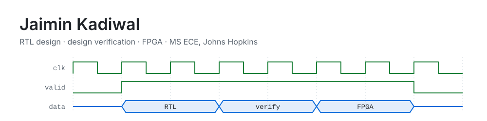

<picture>
  <source media="(prefers-color-scheme: dark)" srcset="assets/banner-dark.svg">
  
</picture>

Hello, I'm a grad student at Johns Hopkins. I build digital hardware and then try to prove it wrong.

Most of what's here is SystemVerilog checked against a reference model, formal proofs and real hardware when
I have it.

Right now I'm adding a controller to my systolic-array accelerator, and next I'm putting a UVM testbench on it.
Below are the projects that are done and verified.

| Project | What it is | Evidence |
|---|---|---|
| [**tensor-mac**](https://github.com/JaiminKadiwal/tensor-mac) | INT8 systolic-array matrix multiply | Matches NumPy on 500 random tiles; formal proof that the accumulator never overflows |
| [**verified-rtl-blocks**](https://github.com/JaiminKadiwal/verified-rtl-blocks) | FIFO, skid buffer, round-robin arbiter | 7,500+ random checks; formal proofs of no overflow and no starvation |
| [**fpga-keyword-spotting**](https://github.com/JaiminKadiwal/fpga-keyword-spotting) | int8 neural net in VHDL on an Artix-7 | Bit exact with Python on 128/128 vectors, on the board |
| [**risc8-rtl-to-gdsii**](https://github.com/JaiminKadiwal/risc8-rtl-to-gdsii) | 8-bit CPU from Verilog to 45 nm layout | Six-corner sign-off at 7 ns with +1.24 ns slack |
| [**Radiation-hardened SRAM**](https://github.com/JaiminKadiwal/HP13T-fault-tolerance-SRAM-cell) | Reproduced a published 16T cell, then removed 3 transistors | Read SNM +33%, hold SNM -64% |

**Tools:** SystemVerilog, VHDL, Verilator, Icarus, cocotb, SymbiYosys, Yosys, Vivado, Cadence Genus / Innovus /
Xcelium, Python, C++.
